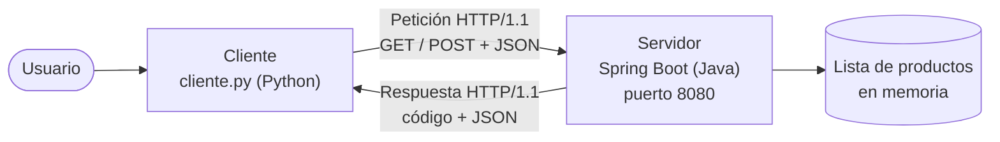
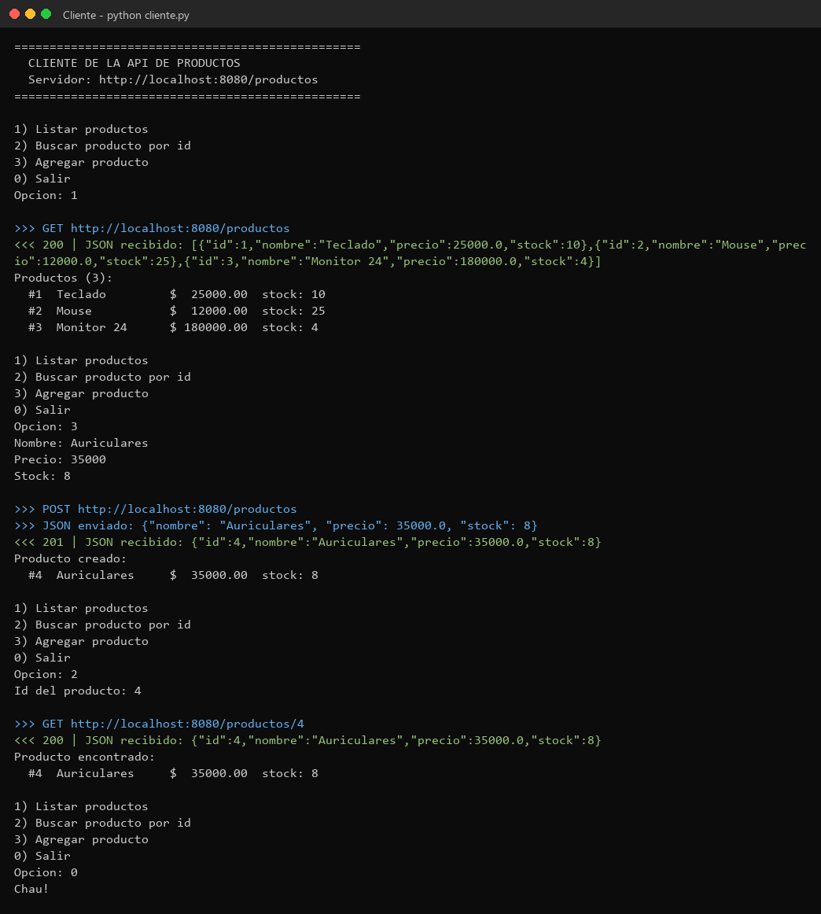
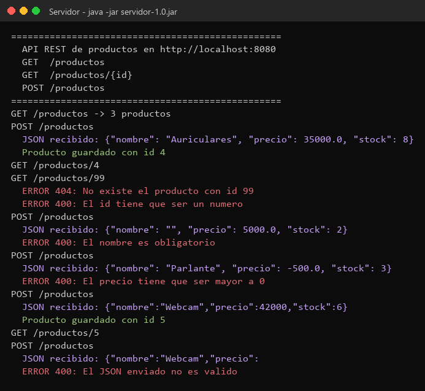
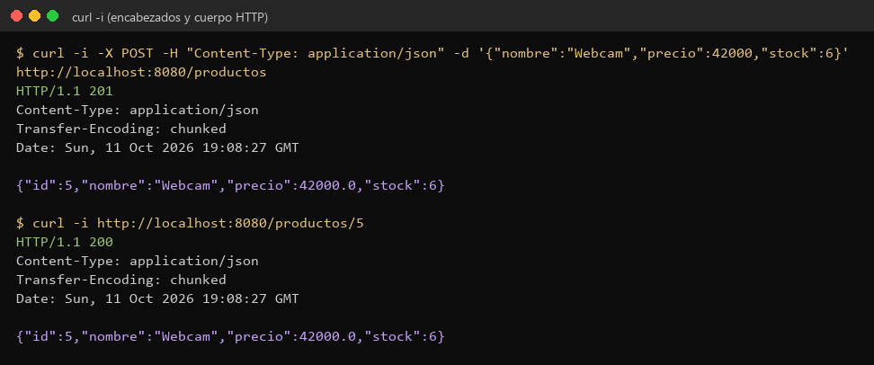
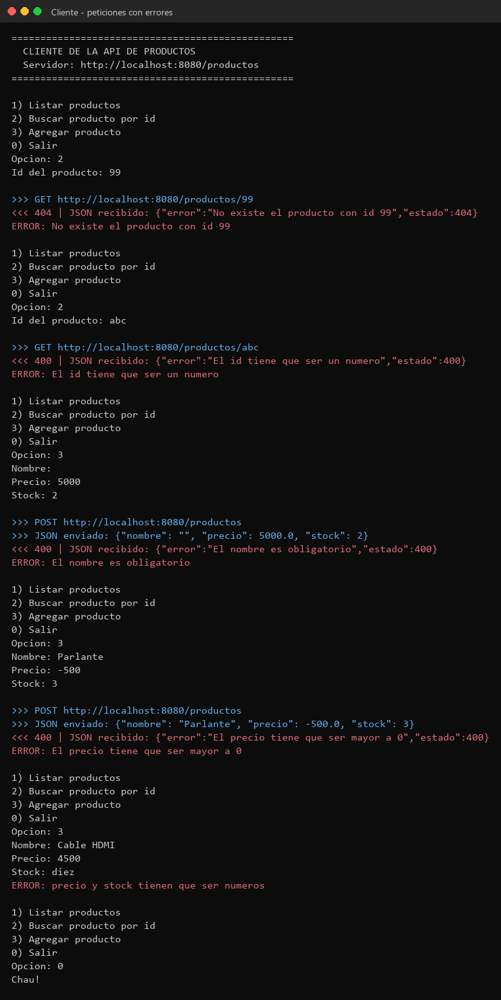
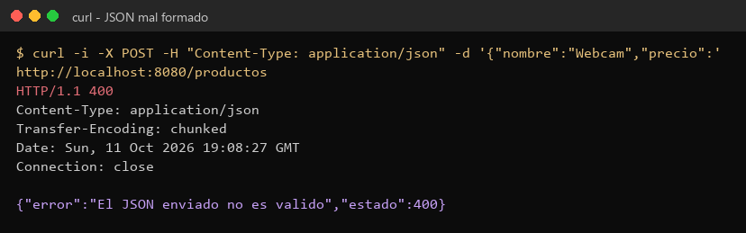
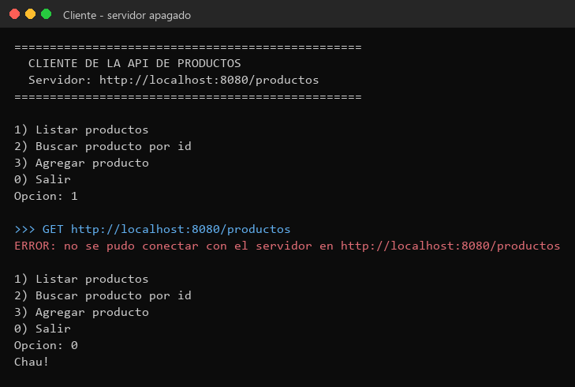

# TP7 — API REST de productos y cliente independiente

| | |
|---|---|
| **Alumno** | Ignacio Ruiz — DNI 39.040.338 |
| **Materia** | Desarrollo de Aplicaciones para Ambientes Distribuidos |
| **Cátedra / Docente** | Lic. Gabriel Artaza |
| **Trabajo** | Trabajo Práctico N° 7 — Integración entre Capas y Consumo de APIs |
| **Servidor** | Java 21 + Spring Boot 3.3 (REST sobre HTTP/JSON) |
| **Cliente** | Python 3 (solo librerías que vienen con Python: `urllib` y `json`) |

Un servidor guarda una lista de **productos**. Un cliente, que es otro programa
aparte, se conecta por la red para ver, buscar y agregar productos. Se pasan
los datos en formato **JSON** usando **HTTP** (lo mismo que usan las páginas web).

---

## Archivos

```
TP7/
├── servidor/                      API REST (Spring Boot)
│   ├── pom.xml
│   └── src/main/java/tp7/
│       ├── Servidor.java          Arranca el servidor en el puerto 8080
│       ├── Producto.java          El dato que viaja: id, nombre, precio y stock
│       ├── ProductoController.java  Los endpoints GET y POST
│       └── ManejoDeErrores.java   Convierte los errores en respuestas JSON con su código
├── cliente/
│   └── cliente.py                 Cliente de consola con menú
├── capturas/
└── README.md
```

## Endpoints

| Método | Ruta | Qué hace | Respuesta |
|---|---|---|---|
| `GET` | `/productos` | Devuelve todos los productos | `200` + lista en JSON |
| `GET` | `/productos/{id}` | Devuelve un producto | `200` + producto, o `404` si no existe |
| `POST` | `/productos` | Recibe un producto en JSON y lo guarda | `201` + producto con su id nuevo |

Ejemplo de lo que manda el cliente en el `POST`:

```json
{"nombre": "Auriculares", "precio": 35000.0, "stock": 8}
```

y lo que contesta el servidor:

```json
{"id": 4, "nombre": "Auriculares", "precio": 35000.0, "stock": 8}
```

Los productos se guardan en memoria (una lista), así que al reiniciar el
servidor vuelven a ser los 3 del principio.

---

## Arquitectura



Paso a paso:

1. El cliente convierte los datos a texto JSON (**marshalling**).
2. Lo manda al servidor por HTTP.
3. El servidor convierte ese texto en un `Producto` de Java (**unmarshalling**).
4. El servidor contesta con un código (por ejemplo `200` o `404`) y un JSON.
5. El cliente lee ese JSON y lo muestra en pantalla.

Como solo viaja texto JSON, no importa que el servidor esté en Java y el
cliente en Python: se entienden igual.

---

## Manejo de errores

**En el servidor** (`ManejoDeErrores.java`): si algo sale mal, contesta con un
código y un mensaje, por ejemplo `{"estado": 404, "error": "..."}`:

| Caso | Código |
|---|---|
| Producto que no existe (`/productos/99`) | `404 Not Found` |
| Ruta que no existe (`/cualquiercosa`) | `404 Not Found` |
| Id que no es número (`/productos/abc`) | `400 Bad Request` |
| JSON mal escrito | `400 Bad Request` |
| Nombre vacío, precio menor o igual a 0 o stock negativo | `400 Bad Request` |
| Método que no corresponde (ej. `DELETE`) | `405 Method Not Allowed` |
| Cualquier otro error inesperado | `500 Internal Server Error` |

**En el cliente** (`cliente.py`):

- Si el servidor contesta con un error, muestra el código y el mensaje que vino
  en el JSON.
- Si el servidor está apagado, avisa que no se pudo conectar y el menú sigue
  andando.
- Si el usuario pone letras en el precio o el stock, avisa sin llamar al
  servidor.

---

## Cómo compilar y ejecutar

**Requisitos:** Java 21, Maven y Python 3.

**Terminal A — servidor** (desde la carpeta `TP7/servidor`):

```bash
mvn package
java -jar target/servidor-1.0.jar
```

La primera vez Maven descarga Spring Boot, así que tarda un poco. El servidor
queda escuchando en `http://localhost:8080`. Se corta con `Ctrl+C`.

**Terminal B — cliente** (desde la carpeta `TP7/cliente`):

```bash
python cliente.py                  # servidor en esta misma compu
python cliente.py 192.168.0.142    # servidor en otra compu de la red
```

También se puede probar la API sin el cliente, con `curl` o desde el navegador
entrando a `http://localhost:8080/productos`.

---

## Capturas

### Captura 1 — Invocación exitosa

El cliente lista los productos, agrega uno nuevo (`POST`, responde `201`) y lo
busca por id. En cada pedido se ve lo que se manda (`>>>`), lo que vuelve
(`<<<`) y abajo los datos ya convertidos y mostrados en forma de tabla.



### Captura 2 — Estructura de los datos (JSON)

En la consola del servidor se ve el **JSON tal cual llega** en cada `POST`, y
qué pasa con cada pedido:



Con `curl -i` se ve el mensaje HTTP completo que viaja por la red: el código
(`201`, `200`), el encabezado `Content-Type: application/json` y el cuerpo en
JSON:



### Captura 3 — Manejo de errores

Producto que no existe (`404`), id con letras (`400`), nombre vacío (`400`),
precio negativo (`400`) y stock con letras (lo frena el cliente):



JSON mal escrito mandado con `curl` (`400`):



Cliente con el servidor apagado: avisa y no se cierra.



> Las salidas completas también están como `.txt` en `capturas/`.

---

## Autor

Ignacio Ruiz — DNI 39.040.338
Trabajo Práctico N° 7 — Desarrollo de Aplicaciones para Ambientes Distribuidos
