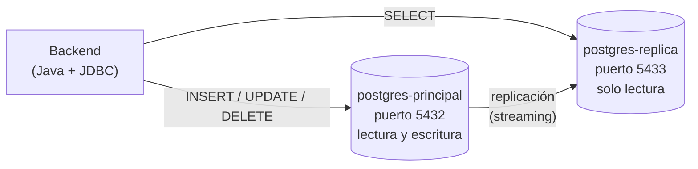
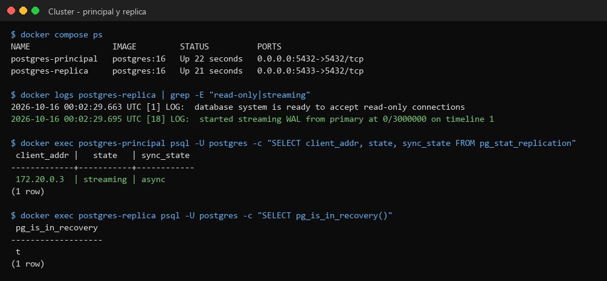
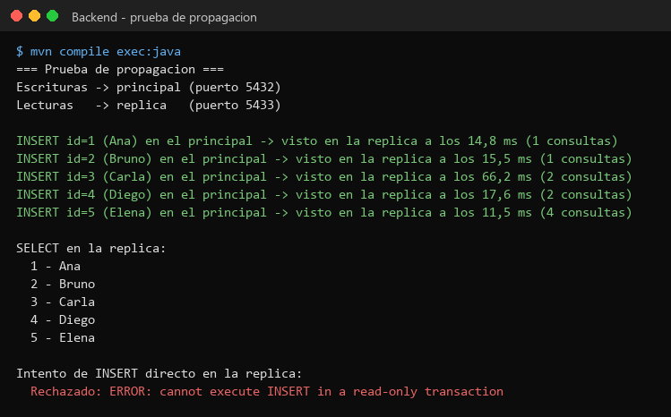
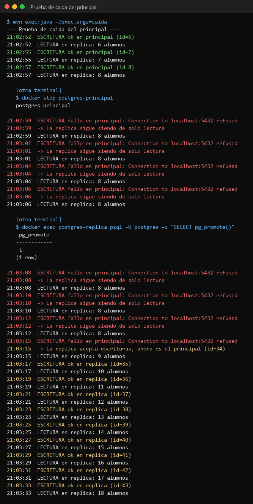

# TP8 — Base de datos replicada con PostgreSQL

Trabajo Práctico N° 8 — Desarrollo de Aplicaciones para Ambientes Distribuidos
(Lic. Gabriel Artaza).

**Alumno:** Ignacio Ruiz — DNI 39.040.338
**Base de datos:** PostgreSQL 16 en Docker · **Backend:** Java + JDBC

Hay dos bases de datos: el **principal**, donde se guardan los datos, y la
**réplica**, que es una copia que solo se puede leer. El programa en Java
guarda en el principal y lee de la réplica (Opción A de la consigna).

> La consigna dice carpeta `/TP7`, pero como `TP7/` ya es el trabajo anterior,
> este va en `TP8/`.

---

## Archivos

```
TP8/
├── docker-compose.yml   Levanta el principal y la réplica
├── init.sql             Crea la tabla alumnos
├── replicacion.sh       Deja que la réplica se conecte al principal
├── backend/
│   ├── pom.xml
│   └── src/main/java/tp8/Main.java   El programa
├── capturas/
└── README.md
```

---

## Esquema



La réplica copia todo lo del principal y después va recibiendo cada cambio.
El principal no espera a la réplica, así que la copia puede ir unos
milisegundos atrás.

---

## Cómo ejecutar

Hace falta Docker Desktop abierto, Java 21 y Maven.

**1. Levantar el clúster** (en la carpeta `TP8`):

```bash
docker compose up -d
docker compose ps
```

**2. Prueba de propagación** (en la carpeta `TP8/backend`):

```bash
mvn compile exec:java
```

**3. Prueba de caída** (en la carpeta `TP8/backend`):

```bash
mvn exec:java -Dexec.args=caida
```

Mientras corre, en otra terminal:

```bash
docker stop postgres-principal                                         # se cae el principal
docker exec postgres-replica psql -U postgres -c "SELECT pg_promote()"  # la réplica pasa a ser principal
```

**Para empezar de cero:**

```bash
docker compose down -v
```

> Si sale un error de `TimeZone`, es por la zona horaria de Windows. Ya está
> arreglado en `backend/.mvn/jvm.config`.

---

## Capturas

### 1. Clúster funcionando

Las dos bases andando. Se ve que la réplica es de solo lectura y que está
conectada al principal recibiendo los cambios.



### 2. Escritura en el principal y lectura en la réplica

Se guardan 5 alumnos en el principal y se mide cuánto tardan en aparecer en la
réplica. Al final se intenta guardar directo en la réplica y no lo deja.



### 3. Caída del principal

El programa guarda y lee cada 2 segundos. Se apaga el principal:

- Guardar falla, pero el programa muestra el error y **sigue andando**.
- Leer **sigue funcionando** porque se lee de la réplica.
- Se convierte la réplica en principal (`pg_promote()`) y el programa
  **empieza a guardar ahí**.

(El id salta de 8 a 34 porque Postgres reserva números de antemano; no se
pierde ningún dato.)



> Las salidas completas también están como `.txt` en `capturas/`.

---

## Respuestas

**¿La consistencia es ansiosa o perezosa?**
Perezosa (eventual). El principal no espera a la réplica. Los datos llegaron
entre 11 y 66 ms después, y a veces la réplica todavía no los tenía en la
primera consulta.

**¿El sistema detecta la caída?**
Sí. Sale un error de conexión, el programa lo atrapa y sigue. Mientras no
haya principal, solo se puede leer.

**¿Se puede pasar el tráfico a la réplica?**
Sí, pero no es automático: hay que convertir la réplica en principal con
`pg_promote()`. Después el programa guarda ahí.

---

## Autor

Ignacio Ruiz — DNI 39.040.338
Trabajo Práctico N° 8 — Desarrollo de Aplicaciones para Ambientes Distribuidos
