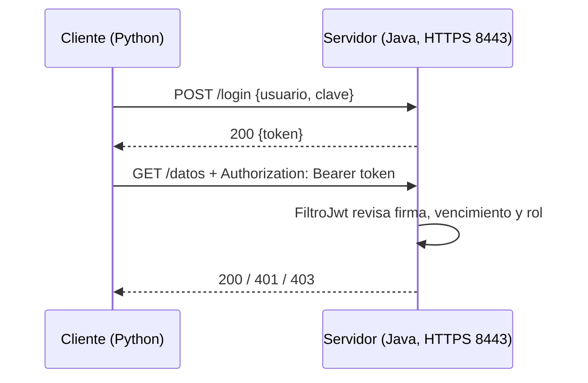

# TP9 — Seguridad con JWT y HTTPS

Trabajo Práctico N° 9 — Desarrollo de Aplicaciones para Ambientes Distribuidos
(Lic. Gabriel Artaza).

**Alumno:** Ignacio Ruiz — DNI 39.040.338
**Servidor:** Java 21 + Spring Boot + jjwt · **Cliente:** Python (sin librerías extra)
**Certificado:** autofirmado, generado con `keytool` (viene con Java)

Un servidor que solo atiende por **HTTPS**. Para entrar hay que hacer login y
el servidor devuelve un **token JWT** firmado. Con ese token se pueden pedir
las rutas protegidas.

| Ruta | Quién puede entrar |
|---|---|
| `POST /login` | Cualquiera (recibe usuario y clave, devuelve el token) |
| `GET /datos` | Cualquiera con un token válido |
| `GET /admin` | Solo con un token de rol `admin` |

Usuarios de prueba: `ana` / `1234` (rol `admin`) y `beto` / `abcd` (rol `usuario`).

> La consigna dice carpeta `/TP8`, pero como `TP8/` ya es el trabajo anterior,
> este va en `TP9/`.

---

## Archivos

```
TP9/
├── servidor/
│   └── src/main/
│       ├── java/tp9/
│       │   ├── Servidor.java           Arranca el servidor
│       │   ├── Jwt.java                Crea y valida los tokens
│       │   ├── FiltroJwt.java          Revisa el token antes de cada ruta protegida
│       │   ├── LoginController.java    POST /login
│       │   └── RecursoController.java  GET /datos y GET /admin
│       └── resources/
│           ├── application.properties  Puerto 8443, HTTPS y duración del token
│           └── keystore.p12            Certificado y clave del servidor
├── cliente/
│   ├── cliente.py        Hace todas las pruebas
│   └── certificado.pem   Certificado público, para que el cliente confíe en el servidor
├── capturas/
└── README.md
```

---

## Cómo funciona



- Todo viaja cifrado con **TLS**. El cliente comprueba que el certificado del
  servidor sea el de `certificado.pem`; si no, no se conecta.
- El token tiene tres partes: cabecera, **payload** (`sub`, `rol`, `iat`,
  `exp`) y **firma**. La firma se hace con una clave secreta que solo conoce el
  servidor, así que si alguien cambia el payload la firma deja de coincidir.
- El token dura 10 minutos (`jwt.segundos=600`).

| Caso | Respuesta |
|---|---|
| Sin token, token roto o vencido, o firma que no coincide | `401` |
| Token válido pero sin el rol necesario | `403` |
| Usuario o clave incorrectos en `/login` | `401` |

---

## Cómo ejecutar

Hace falta Java 21, Maven y Python 3.

**Terminal A — servidor** (en la carpeta `TP9/servidor`):

```bash
mvn package
java -jar target/servidor-1.0.jar
```

**Terminal B — cliente** (en la carpeta `TP9`):

```bash
python cliente/cliente.py
```

**Prueba del token vencido:** se levanta el servidor con tokens de 5 segundos y
se corre el cliente en modo `vencido`:

```bash
java -jar target/servidor-1.0.jar --jwt.segundos=5
python cliente/cliente.py vencido
```

**Si se quiere generar otro certificado** (en la carpeta `TP9`):

```bash
keytool -genkeypair -alias tp9 -keyalg RSA -keysize 2048 -validity 365 -storetype PKCS12 -keystore servidor/src/main/resources/keystore.p12 -storepass tp9clave -dname "CN=localhost" -ext "SAN=dns:localhost,ip:127.0.0.1"
keytool -exportcert -rfc -alias tp9 -keystore servidor/src/main/resources/keystore.p12 -storepass tp9clave -file cliente/certificado.pem
```

> El certificado y las claves están en el repo solo porque es un trabajo
> práctico. En un sistema real no se suben.

---

## Capturas

### 1. Emisión del JWT

Login de `ana`. El servidor contesta con el token en JSON. Abajo se ve el
payload: `sub`, `rol` y `exp` (vencimiento).


### 2. Acceso autorizado por HTTPS

Con el token en el encabezado `Authorization` se entra a `/datos` y a `/admin`
(`200 OK`). Cada pedido muestra que el canal va cifrado con TLS 1.3. Al final,
si se intenta entrar por `http://` sin cifrar, el servidor no lo acepta.


### 3. Rechazos: sin token, token inválido, vencido y sin permiso

- Sin token → `401`
- Token inventado → `401`
- Clave incorrecta → `401`
- `beto` (rol `usuario`) quiere entrar a `/admin` → `403`
- Token vencido (servidor con tokens de 5 segundos) → primero `200` y después
  de 6 segundos `401`


### 4. Tampering

Se toma el token de `beto`, se cambia `"rol": "usuario"` por `"rol": "admin"`
en el payload y se deja la firma original. El servidor se da cuenta de que la
firma no coincide y lo rechaza con `401`.


### Extra: log del servidor y servidor apagado

El servidor muestra cada pedido y por qué lo aceptó o lo rechazó:


Si el servidor está apagado, el cliente avisa en vez de cortarse con un error:


> Las salidas completas también están como `.txt` en `capturas/`.

---

## Autor

Ignacio Ruiz — DNI 39.040.338
Trabajo Práctico N° 9 — Desarrollo de Aplicaciones para Ambientes Distribuidos
