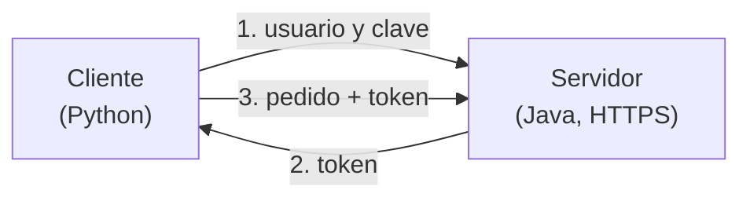
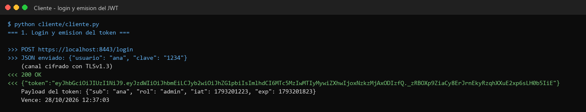
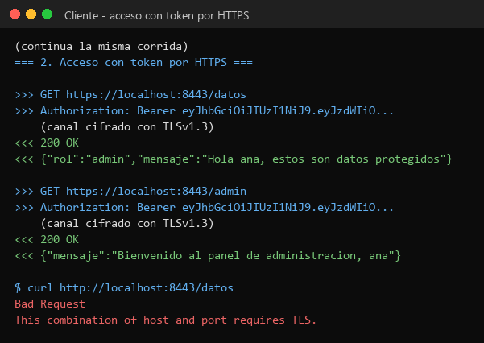
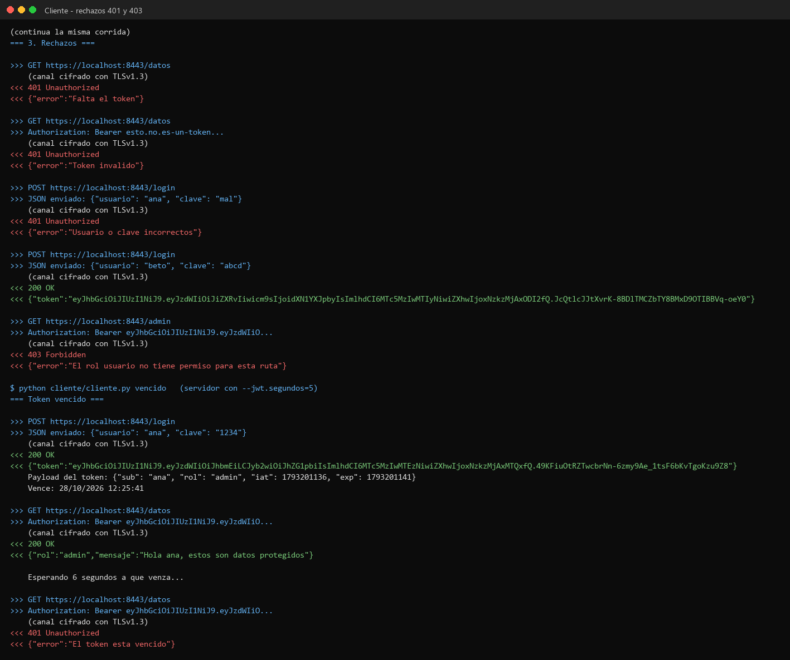
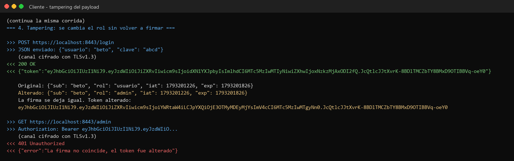
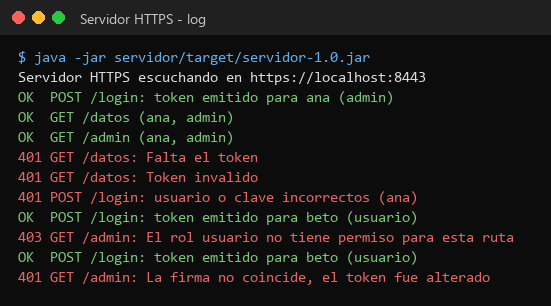
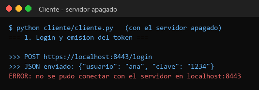

# TP9 — Seguridad con JWT y HTTPS

Trabajo Práctico N° 9 — Desarrollo de Aplicaciones para Ambientes Distribuidos
(Lic. Gabriel Artaza).

**Alumno:** Ignacio Ruiz — DNI 39.040.338
**Servidor:** Java + Spring Boot · **Cliente:** Python
**Herramientas:** jjwt (para los tokens) y keytool (para el certificado)

Un servidor que solo atiende por **HTTPS** (conexión cifrada). Para usarlo hay
que hacer login: el servidor devuelve un **token**, y con ese token se puede
entrar a las rutas protegidas.

| Ruta | Quién puede entrar |
|---|---|
| `POST /login` | Cualquiera, con usuario y clave |
| `GET /datos` | Cualquiera que tenga token |
| `GET /admin` | Solo con token de rol `admin` |

Usuarios: `ana` / `1234` (admin) y `beto` / `abcd` (usuario).

> La consigna dice carpeta `/TP8`, pero como esa ya es del trabajo anterior,
> este va en `TP9/`.

---

## Archivos

```
TP9/
├── servidor/     El servidor (Spring Boot)
│   └── src/main/java/tp9/
│       ├── Servidor.java            Arranca el servidor
│       ├── Jwt.java                 Crea y revisa los tokens
│       ├── FiltroJwt.java           Controla el token antes de cada ruta
│       ├── LoginController.java     El login
│       └── RecursoController.java   Las rutas /datos y /admin
├── cliente/
│   ├── cliente.py        Hace todas las pruebas
│   └── certificado.pem   Certificado del servidor
├── capturas/
└── README.md
```

---

## Cómo funciona



- Todo viaja **cifrado**. El cliente revisa que el servidor tenga el
  certificado correcto antes de mandar nada.
- El token lleva adentro el usuario, el rol y cuándo vence (dura 10 minutos).
  Además lleva una **firma** que solo el servidor sabe hacer: si alguien cambia
  algo del token, la firma ya no coincide y el servidor lo rechaza.
- Si el token falta, está mal o venció, el servidor responde **401**. Si el
  token está bien pero el rol no alcanza, responde **403**.

---

## Cómo ejecutar

Hace falta Java 21, Maven y Python 3.

**Terminal A — servidor** (en la carpeta `TP9/servidor`):

```bash
mvn package
java -jar target/servidor-1.0.jar
```

**Terminal B — cliente** (en la carpeta `TP9`):

```bash
python cliente/cliente.py
```

**Para probar un token vencido**, se arranca el servidor con tokens que duran
5 segundos:

```bash
java -jar target/servidor-1.0.jar --jwt.segundos=5
python cliente/cliente.py vencido
```

> El certificado es autofirmado y está en el repo solo porque es un TP.

---

## Capturas

### 1. Login

`ana` hace login y recibe el token. Abajo se ve lo que tiene adentro: usuario,
rol y vencimiento.



### 2. Entrar con el token por HTTPS

Con el token se entra a `/datos` y `/admin` (`200 OK`). Cada pedido muestra que
va cifrado. Al final se ve que por `http://` sin cifrar el servidor no atiende.



### 3. Rechazos

Sin token, token inventado y clave mala dan `401`. `beto` no puede entrar a
`/admin` (`403`). Y el token vencido: primero anda y a los 6 segundos da `401`.



### 4. Token modificado

Se agarra el token de `beto`, se le cambia el rol a `admin` y se deja la firma
como estaba. El servidor se da cuenta y lo rechaza.



### Extra

Lo que muestra el servidor:



Servidor apagado (el cliente avisa y no se cuelga):



> Las salidas completas también están como `.txt` en `capturas/`.

---

## Autor

Ignacio Ruiz — DNI 39.040.338
Trabajo Práctico N° 9 — Desarrollo de Aplicaciones para Ambientes Distribuidos
